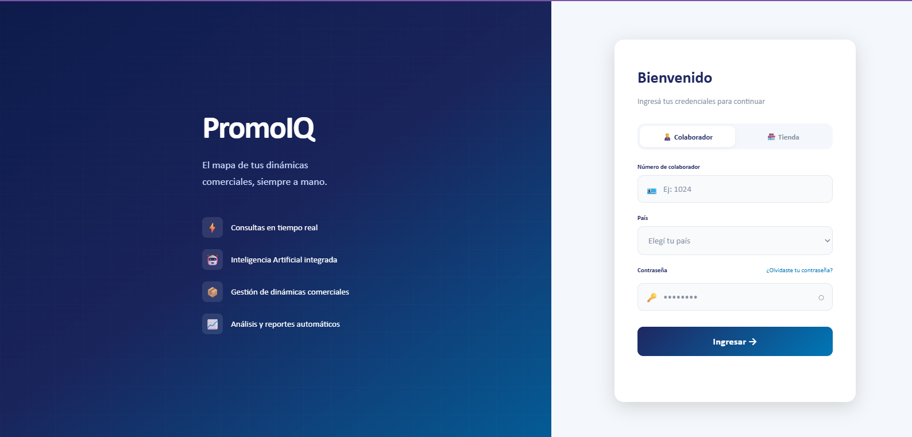
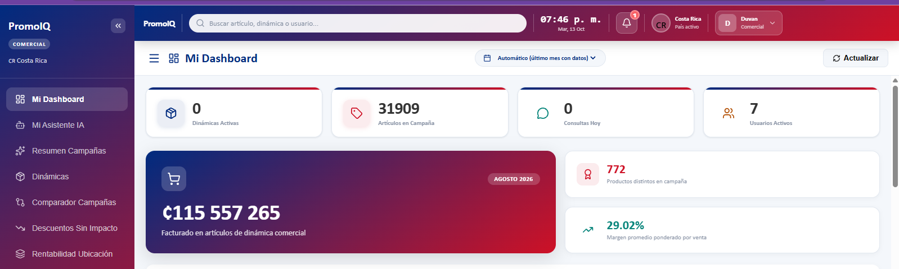
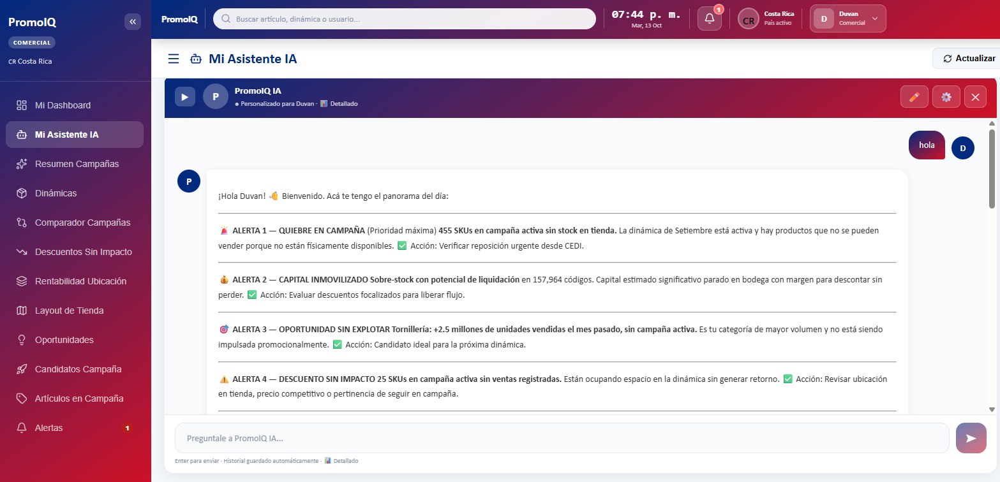
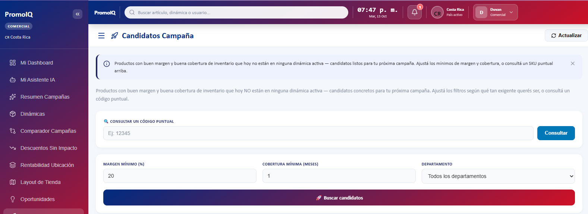

# 📊 PromoIQ — Sistema de Dinámicas Comerciales

Sistema de inteligencia comercial desarrollado en **FastAPI + React con integración de IA (Claude API)**. Automatiza la gestión de campañas promocionales, análisis de inventario y toma de decisiones para equipos comerciales en Costa Rica, Guatemala y El Salvador.

## ✨ Funcionalidades Generales

- **Dinámicas Comerciales** — Creación y seguimiento de campañas con fechas, metas y artículos candidatos
- **Candidatos a Campaña** — Selección de productos por métricas de venta, margen y stock
- **Asistente IA por Rol** — Asistente personalizado con Claude API, con contexto diferenciado por rol
- **Catálogo de Artículos** — Búsqueda global con filtros por estado, precio y ubicación en tienda
- **Layout de Tiendas** — Mapeo espacial de pasillos y zonas cargado desde Excel
- **Exportación** — Reportes a Excel por módulo (candidatos, sobre-stock, tiendas)
- **Notificaciones** — Alertas automáticas diarias vía APScheduler
- **Control de Acceso** — 5 roles con scope de país independiente

## 👥 Roles y Funcionalidades

### 🔴 Superadmin
Visibilidad total del sistema sin restricción de país.
- Gestión de usuarios (crear, editar, desactivar) en todos los países
- Gestión de tiendas y países activos
- Acceso a todas las dinámicas y datos de CR, GT y SV simultáneamente
- Asistente IA con contexto global multi-país

### 🟠 Admin
Administrador por país — mismo alcance que Superadmin pero limitado a su país asignado.
- Gestión de usuarios y tiendas de su país
- Creación y edición de dinámicas comerciales
- Auditoría de operaciones sensibles (`auditoria_log`)
- Asistente IA con contexto del país

### 🟡 Comercial
Rol orientado a la gestión de campañas y análisis de ventas.
- **Dashboard** — Indicadores de ventas del mes, campañas activas y vencidas
- **Dinámicas** — Creación, edición y seguimiento de campañas promocionales
- **Candidatos a Campaña** — Lista de artículos con potencial para incluir en dinámicas, filtrable por departamento y tipo de campaña
- **Resumen de Campañas** — Fichas detalladas por dinámica con descripción y artículos participantes
- **Asistente IA** — Consultas sobre ventas, campañas activas, artículos candidatos y márgenes

### 🟢 Planning
Rol enfocado en control de inventario y abastecimiento.
- **Sobre-stock por Departamento** — Productos con existencia por encima del máximo definido, filtrable por tienda, estado del artículo y departamento, con monto inmovilizado en ₡
- **Análisis de Mínimos/Máximos** — Control de parámetros de reorden por SKU y tienda
- **Exportación Excel** — Descarga de sobre-stock por tienda y departamento
- **Asistente IA** — Consultas sobre rotación, excesos de inventario y parámetros de stock

### 🔵 Tiendas
Rol para personal de piso de tienda — acceso simplificado y enfocado en operación diaria.
- **Selector de Tienda** — Persiste en `localStorage`; modal en primer ingreso, botón "Cambiar" siempre disponible
- **Dashboard de Tienda** — Campañas activas propias de la tienda y campañas finalizadas del mes anterior
- **Catálogo** — Consulta de artículos con ubicación exacta en tienda (pasillo, zona)
- **Distribución por Ubicación** — Vista de productos por zona con barras de progreso
- **Asistente IA** — Consultas sobre artículos, precios y ubicaciones dentro de su tienda específica

## 🤖 Asistente IA

El asistente usa **Claude API** con contexto dinámico generado en tiempo real según el rol:

| Rol | Contexto inyectado |
|-----|--------------------|
| Comercial | Ventas del mes, campañas activas, artículos candidatos, márgenes |
| Planning | Sobre-stock, mínimos/máximos, rotación de inventario |
| Admin | Vista general de dinámicas y usuarios por país |
| Tiendas | Catálogo, precios y ubicación de productos en su tienda |
| Superadmin | Vista global multi-país de todas las operaciones |

Cada conversación es persistente por sesión. El asistente tiene nombre personalizable y rechaza consultas fuera de su scope por diseño.

## 🏗️ Arquitectura

```
React Frontend (SPA)
        ↓
FastAPI Backend (REST API)
        ↓
SQL Server Express (Almacenamiento)
        +
Claude API (Asistente IA por rol)
```

**Patrones implementados:** Role-based access control, country scoping, session-based AI conversations, bulk insert con TVP, stored procedures para operaciones complejas

## 💻 Stack Tecnológico

| Capa | Tecnología |
|------|-----------|
| Backend | FastAPI, Python |
| Base de Datos | SQL Server Express |
| Frontend | React, CSS custom properties |
| IA | Claude API (Anthropic) |
| Procesamiento de datos | openpyxl, pandas |
| Reportes | openpyxl (Excel) |
| Autenticación | JWT + control por rol y país |
| Scheduling | APScheduler |

## 📸 Screenshots

| Login | Dashboard Comercial |
|-------|-------------------|
|  |  |

| Asistente IA | Candidatos Campaña |
|--------------|-------------------|
|  |  |

## 🔒 Características de Seguridad

✅ Control de acceso basado en roles (5 niveles)  
✅ Scope por país — cada usuario solo ve sus datos  
✅ Validaciones en múltiples niveles (BD + API)  
✅ Auditoría integrada en operaciones sensibles (`auditoria_log`)  
✅ Gestión de secretos por variables de entorno  
✅ Anti-escalamiento de privilegios por país  
✅ Bloqueo de cuenta por intentos fallidos  

## 📊 Base de Datos

- **21 tablas** normalizadas con integridad referencial
- Stored procedures para cálculos complejos de inventario y ventas
- Bulk insert optimizado con Table-Valued Parameters (TVP)
- Control de consumo de tokens por país y por rol
- APScheduler ejecuta job diario de notificaciones a las 8 AM

## 🌎 Multi-país

El sistema opera en **Costa Rica 🇨🇷, Guatemala 🇬🇹 y El Salvador 🇸🇻** con datos, usuarios y dinámicas completamente independientes por país.

## 🚀 Correr Localmente

### Requisitos

- Python 3.10+
- SQL Server Express
- Node.js 18+

### Backend

**1. Clonar el repositorio**
```bash
git clone https://github.com/DuvanJ/promoiq.git
cd promoiq
```

**2. Instalar dependencias**
```bash
cd backend
pip install -r requirements.txt
```

**3. Configurar variables de entorno**
```bash
cp .env.example .env
```

Editar `.env`:
```env
DB_SERVER=NOMBRE_SERVIDOR\SQLEXPRESS
DB_NAME=PromoIQ
DB_USER=tu-usuario
DB_PASSWORD=tu-contraseña
ANTHROPIC_API_KEY=tu-api-key
SECRET_KEY=tu-secret-key
```

> ⚠️ Nunca subas el archivo `.env` al repositorio — está incluido en `.gitignore`

**4. Restaurar la base de datos**

Ejecutar en SQL Server Management Studio:
```
scripts/BD_PromoIQ.sql
```

**5. Iniciar el servidor**
```bash
uvicorn app.main:app --reload
```

API disponible en: `http://localhost:8000`

### Frontend

```bash
cd frontend
npm install
npm start
```

App disponible en: `http://localhost:3000`

### Credenciales por defecto
```
Email:      admin@promoiq.com
Contraseña: Admin123!
```

> ⚠️ Cambiar contraseña en primer acceso

## 📝 Notas Importantes

- **Zona horaria:** Costa Rica (UTC -6)
- **Moneda:** Colones Costarricenses (₡) / Quetzales / Dólares según país
- **IA:** Requiere API key de Anthropic con acceso a Claude

## 👤 Autor

**Duvan** 
[GitHub](https://github.com/DuvanJ)
